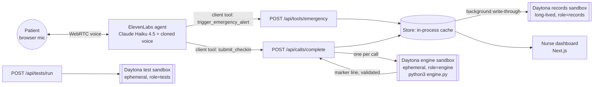

# Still Kicking

> "How are you today?" "Still kicking!"

**Demo video (2 min):** https://www.loom.com/share/ecdde797d42845019106adb87be5bd30  
**Live app:** https://still-kicking.vercel.app (nurse dashboard) · https://still-kicking.vercel.app/patient/walt (patient call screen)

A warm AI nurse check-in for older adults living at home. It talks with them, compares today with their own baseline, tells a skipped pill apart from a real change, writes the caregiver a plain-language summary, and alerts a human the moment something sounds serious.

Built at a hackathon with **ElevenLabs** (the voice agent) and **Daytona** (patient records, per-call analysis and tests, all in sandboxes), by Carolina Bosch and a squad of Claude Code agents.

**It never diagnoses, prescribes or changes medication. It listens, records, flags and hands off to humans.**

## What it does

- **Daily voice check-in.** The Still Kicking nurse (Carolina's cloned voice) confirms who answered, screens for red flags first, then runs a short check adapted from the INTERACT "Stop and Watch" early-warning tool: pain, eating and drinking, swelling, mood (PHQ-2), orientation, medications, and a few condition-specific questions (heart failure, COPD, diabetes, blood pressure, dementia).
- **Emergency path during the call.** If the person mentions chest pain, trouble breathing, a fall, stroke signs, fainting, bleeding or not feeling safe, the agent fires `trigger_emergency_alert` before it says anything else and tells them to hang up and call 911. The nurse dashboard shows a red alert with a simulated SMS to the nurse and the caregiver.
- **Analysis after the call.** The structured record goes to a fresh Daytona sandbox that runs the engine against the patient's history: trend flags, pattern clusters ("possible heart failure worsening"), medication attribution (likely adherence-related, likely a clinical change, or unclear), a traffic-light status, and a caregiver summary.
- **Missed calls.** Three unanswered attempts in a row raise an urgent "Unable to reach after 3 attempts" alert.
- **Nurse dashboard.** Patients with status lights, an alert queue (acknowledge, add a note, resolve), the simulated SMS log, engine findings with the sandbox id, and a "Run tests in Daytona" button.

> **About INTERACT "Stop and Watch".** We adapt ideas from INTERACT's Stop and Watch early-warning tool (an approach AHRQ describes). It helps caregivers notice and report changes from a person's usual condition, such as new confusion, eating less, moving less or more weakness. It is a communication tool, not a diagnostic score, and it does not decide on its own who needs major care. It was designed for care settings, so using its ideas for people living at home, and our thresholds, would need clinical validation before real use.


Three synthetic patients ship with 14 days of history:

| Patient | Conditions | Story |
|---|---|---|
| Rosa (p1), 78 | COPD, hypertension | Stable baseline |
| Walt (p2), 83 | Heart failure, hypertension | Skipped Furosemide, legs swelling |
| Edie (p3), 86 | Dementia/MCI, hypertension | New confusion, burning when she pees |

## How it works



1. "Start check-in call" asks our server for a short-lived ElevenLabs conversation token (the agent is private; the API key never reaches the browser) and opens a WebRTC session with the patient's dynamic variables.
2. During the call, the agent's client tools run in the browser and POST to our API. An emergency is written to the in-memory store and returns at once; the Daytona write happens in the background.
3. At the end of the call, `submit_checkin` sends the structured record. The server normalizes it, saves it, and runs `engine/engine.py` in a brand-new Daytona sandbox with the patient, up to the last 30 calls and the new record.
4. The engine's output is validated and turned into findings, a caregiver summary and alerts, shown on the dashboard with the sandbox id and timing.

## How we use Daytona

Daytona is where the patient records live and where every piece of analysis runs. There are three kinds of sandboxes, all labeled `app=still-kicking`.

**1. Records sandbox (`role=records`), long-lived.**
Patient records (profile, 14-day history, call attempts, alerts, last analysis) are JSON files in one persistent sandbox: `/home/daytona/records/index.json` and `/home/daytona/records/patients/<id>.json`. We planned to use a Daytona Volume, but `volume.get(name, create)` returned "Access denied" on our account, so we switched to a dedicated records sandbox. It is found by label or created if missing, never auto-deleted, auto-stops after 60 idle minutes and restarts on the next access (its filesystem survives a stop). The server keeps an in-process cache and writes through to the sandbox in the background, coalesced per patient, with one retry that re-resolves the sandbox. That way an emergency alert never waits on the network. If Volumes become available, only `records.ts` changes: mount the volume at the same path. See [`src/lib/daytona/records.ts`](src/lib/daytona/records.ts).

**2. Engine sandbox (`role=engine`), fresh and ephemeral per finished call.**
Every check-in gets its own sandbox: upload `engine/*.py` and one `input.json`, run `python3 -B engine.py input.json`, read one marker line from stdout, delete the sandbox. We chose a fresh sandbox over a warm one so one patient's data never sits next to another's, and a bad run can't affect the next. The engine is Python stdlib only, so nothing is installed. Against real Daytona today, Walt's check-in took about 1.1 s end to end, about 0.86 s of it in the sandbox. See [`src/lib/daytona/engine.ts`](src/lib/daytona/engine.ts) and [`engine/`](engine/).

**3. Test sandbox (`role=tests`), fresh and ephemeral per run.**
"Run tests in Daytona" uploads the engine and `engine/tests/`, runs pytest if the image has it or can install it quickly, and otherwise falls back to `unittest`. The dashboard shows passed and failed counts, the output tail and the sandbox id. Today: 36 passed, 0 failed, 3.6 s.

**Guardrails** ([`src/lib/daytona/client.ts`](src/lib/daytona/client.ts)):
- **Labels** on every sandbox (`app`, `role`, plus `patient` on engine runs), so they are easy to find and clean up.
- **Timeouts at every step:** create 30 s, upload 15 s, engine run 20 s, overall engine budget 60 s; test run 90 s, budget 150 s; records I/O 15 s.
- **Cleanup:** ephemeral sandboxes are deleted in `finally`. If the delete fails we stop the sandbox instead (ephemeral sandboxes are deleted on stop), and a 5-minute auto-stop catches anything left behind if the server process dies.
- **Untrusted output:** whatever the engine prints is untrusted. [`engine-output.ts`](src/lib/daytona/engine-output.ts) finds the marker line, checks every enum (status, severity, attribution, alert kind), caps every string and list, drops unknown fields, and rejects the whole result if anything is malformed. The record from the voice agent is normalized the same way before it is stored ([`src/lib/store/index.ts`](src/lib/store/index.ts)).
- **No secrets in sandboxes:** no host environment variables go in. A sandbox receives only the engine source and the input JSON.
- **Speakable errors:** failures become short messages the agent can say ("I saved the check-in, but the analysis didn't finish. The nurse will review it."), with an HTTP status for the API routes.

One rule runs in-process on purpose: the missed-call count ([`src/lib/daytona/attempts.ts`](src/lib/daytona/attempts.ts)), because the dashboard must update instantly. It mirrors `engine/attempts.py`, and `engine/tests/test_attempts.py` pins the behavior both follow.

## How we use ElevenLabs

- **Conversational agent** "Still Kicking Nurse", created and updated by [`scripts/create-agent.mjs`](scripts/create-agent.mjs). The prompt and first message live in [`docs/agent-prompt.md`](docs/agent-prompt.md) as the single source of truth.
- **LLM:** Claude Haiku 4.5 (`claude-haiku-4-5`), selected in the ElevenLabs agent config, temperature 0.2, for fast and reliable tool calls.
- **Voice:** Carolina's cloned voice on `eleven_v4_turbo`, slowed to 0.9x for older listeners. Turn-taking is "patient" with a 10 s turn timeout, because older adults pause mid-sentence.
- **Client tools** (run in the browser, handled in [`src/components/Conversation.tsx`](src/components/Conversation.tsx)):
  - `trigger_emergency_alert(patient_id, red_flag, quote)` → `POST /api/tools/emergency`, fired the moment a red flag is heard.
  - `submit_checkin(record)` → `POST /api/calls/complete`, called once at the end with the structured record; the client adds `call_id` and `timestamp`.
- **System tool `end_call`:** the agent hangs up after the goodbye or after the 911 instruction.
- **Dynamic variables** at session start: `patient_id`, `preferred_name`, `tone`, `language`, `caregiver_name`, `medications`, `conditions`, `next_call_time`, `today_weekday` (for the orientation question).
- **Private agent:** auth is enabled, so the browser connects over WebRTC with a short-lived conversation token from [`src/app/api/elevenlabs/token/route.ts`](src/app/api/elevenlabs/token/route.ts).

## Safety and responsible AI

- **Never diagnoses or advises.** The prompt forbids diagnoses and any advice on medicines, doses or treatment; medical questions go to the nurse. Findings are worded as things for the nurse to review ("possible heart failure worsening"), never as a diagnosis.
- **Emergencies go to 911 and to humans.** On any red flag the agent alerts the nurse and caregiver first, then tells the person to hang up and call 911. It never says help is on the way and never says it called 911, because it didn't.
- **Records only what was said.** The agent uses `null` for anything not asked or unclear, and reports an extraction confidence.
- **Privacy on the call.** If someone other than the patient answers, the agent gives no health information.
- **Synthetic data only.** All patients, phone numbers and histories in this repo are made up. Public repo, no keys in code.
- **What real use would need:** BAAs with every vendor that touches health data (voice, LLM, sandbox hosting), encryption of records at rest and in transit, access control and audit logs on the dashboard, clinical validation of the red-flag screen and pattern rules with nurses, consent, and real escalation to on-call staff.

## Setup

Requires Node 20+ and Python 3.9+ (Python only for running engine tests locally).

```bash
cp .env.example .env.local   # fill in your own keys; never commit them
npm install
node --env-file=.env.local scripts/create-agent.mjs   # creates the agent, prints ELEVENLABS_AGENT_ID
# add ELEVENLABS_AGENT_ID to .env.local
npm run dev                  # http://localhost:3000 (we ran it with: npm run dev -- -p 3600)
```

Environment variables (see [`.env.example`](.env.example)):
- `ELEVENLABS_API_KEY`, `ELEVENLABS_VOICE_ID`, `ELEVENLABS_AGENT_ID`
- `DAYTONA_API_KEY`, `DAYTONA_API_URL` (defaults to `https://app.daytona.io/api`)
- No Anthropic key is needed: the Claude LLM runs inside the ElevenLabs agent.

Run the engine tests locally:

```bash
python3 -m unittest discover -s engine/tests -t engine/tests
```

Use Chrome or Safari for the call (it needs microphone permission). "Reset demo" on the dashboard restores the three seeded patients.

## What's real, simulated, and not built

| Part | Status |
|---|---|
| Patient records in a Daytona records sandbox | Real, verified against Daytona |
| Engine in a fresh Daytona sandbox per call | Real (Walt: 1.1 s total, about 0.86 s in the sandbox) |
| Tests in a Daytona sandbox | Real (36 passed, 3.6 s) |
| Emergency alert route | Real (0.14 s) |
| 3 missed calls → urgent alert | Real |
| ElevenLabs agent, client tools, record extraction | Real, verified by typed text over the live agent connection: the emergency tool fired 1.1 s after "chest pressure", and a full heart-failure check-in was extracted correctly |
| Full check-in by microphone | Pending live test |
| SMS to nurse and caregiver | Simulated: shown in the alert's SMS log, nothing is sent |
| Patients and history | Synthetic, seeded |
| Phone calls (Twilio) | Not built: calls run in the browser |
| Setup calls | Not built: patients are seeded |
| Spanish | Not built (the prompt takes a `language` variable, untested) |

## What's next

- Real outbound phone calls through Twilio at each person's preferred time.
- Real SMS to the nurse and caregiver.
- A setup call that builds the patient profile and baseline by voice.
- Spanish check-ins.
- Move records from the records sandbox to a Daytona Volume once our account has access.

## Team

Carolina Bosch, with a squad of Claude Code agents (lead, voice, sandbox, builder, demo).

## Disclaimer

Prototype. Not a medical device. Not HIPAA-compliant as-is. Not a replacement for 911. This repo uses synthetic demo patients only: never commit real names, phone numbers, transcripts or keys.

## License

MIT
